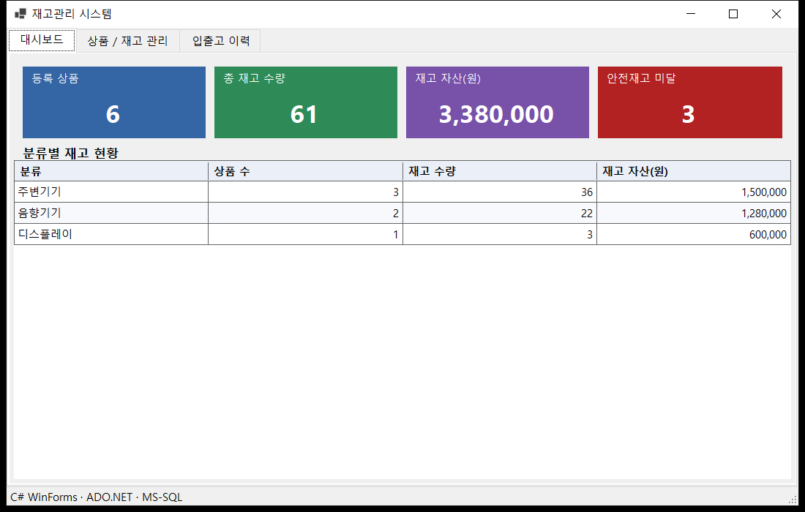
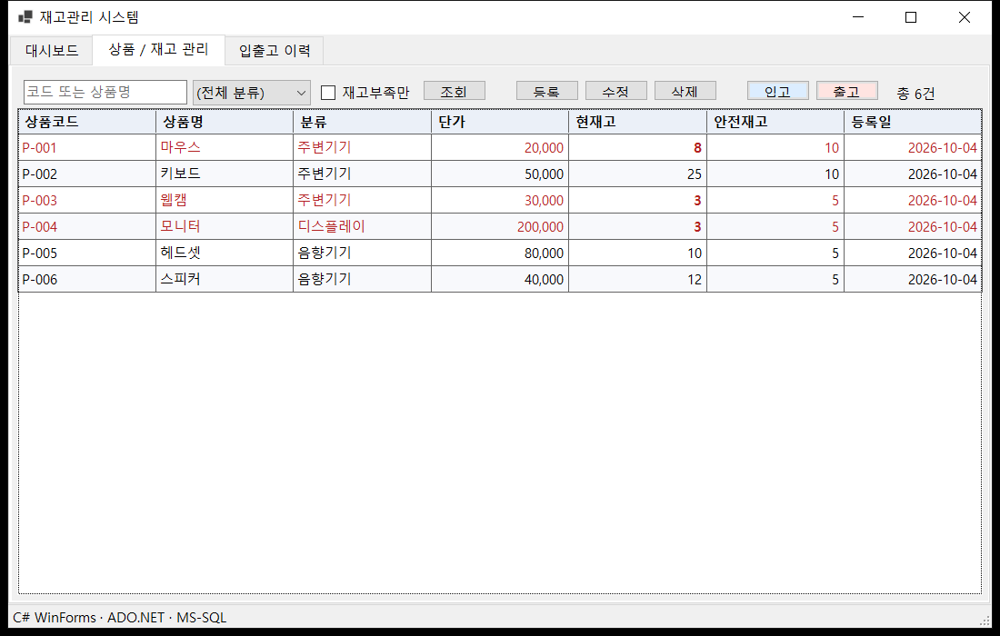
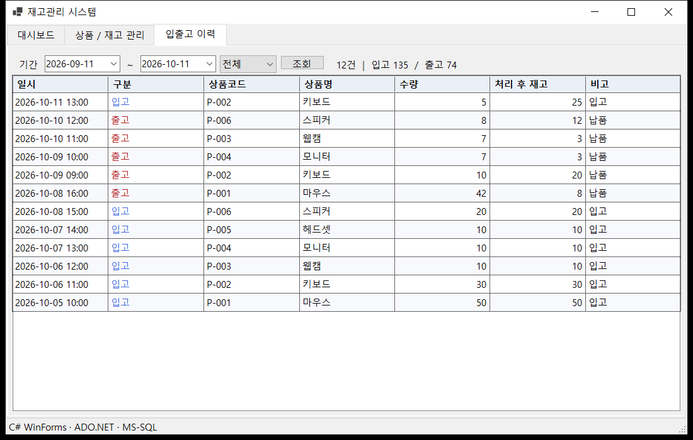
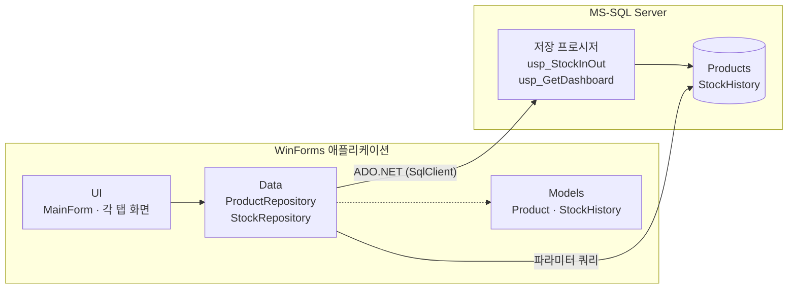
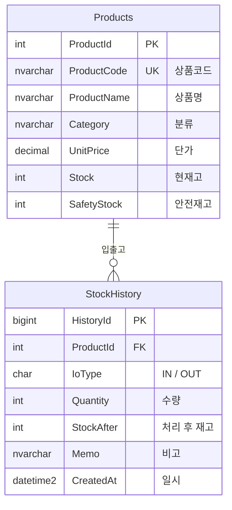
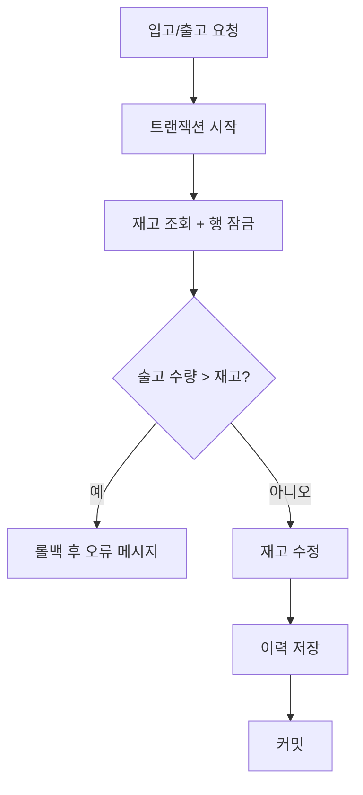

# 재고관리 시스템

C# WinForms + MS-SQL 기반의 재고관리 업무 프로그램입니다.

## 화면
| 대시보드 | 상품 / 재고 관리 | 입출고 이력 |
|---|---|---|
|  |  |  |

> 화면의 데이터는 모두 샘플 데이터입니다.

## 기술 스택
C# / .NET 8 · Windows Forms · MS-SQL Server · ADO.NET

## 시스템 구조


## ERD


## 입출고 처리 흐름


## 주요 기능
- 대시보드: 재고 현황 요약, 분류별 집계
- 상품 관리: 검색·필터, 등록/수정/삭제, 안전재고 미달 강조
- 입출고 처리: 재고 부족 시 출고 차단
- 입출고 이력: 기간·구분별 조회

## 설계 포인트
- 입출고는 저장 프로시저에서 **트랜잭션**으로 처리 (재고 변경 + 이력 기록)
- `CHECK`, `UNIQUE`, `FK` 제약 조건으로 데이터 무결성 보장
- 모든 쿼리 **파라미터 바인딩**으로 SQL Injection 방지
- Models / Data / UI 계층 분리

## 트러블슈팅

### 1. 동시 출고 시 재고가 음수가 되는 문제
- **문제**: 재고를 조회한 뒤 차감하는 사이에 다른 출고가 끼어들면, 두 요청 모두 재고 확인을 통과해 재고가 음수가 될 수 있음
- **해결**: 조회 시 `WITH (UPDLOCK, ROWLOCK)`으로 해당 행을 잠가 트랜잭션이 끝날 때까지 다른 요청이 대기하도록 처리. DB에도 `CHECK (Stock >= 0)`을 걸어 이중으로 방어

### 2. 입고 이력이 전부 "출고"로 표시되는 문제
- **문제**: 이력 화면에서 입고 건까지 모두 출고로 표시됨
- **원인**: 구분 컬럼이 `CHAR(3)`이라 `'IN'`이 `'IN '`(공백 포함)으로 저장되어 C#의 `== "IN"` 비교가 실패. SQL은 비교 시 뒤 공백을 무시해서 조회 조건은 정상 동작해 원인을 찾기 어려웠음
- **해결**: 읽어올 때 `Trim()` 처리

### 3. 업무 오류 메시지 전달
- **문제**: 프로시저 내부 오류(재고 부족 등)가 사용자에게 DB 오류 그대로 노출됨
- **해결**: 프로시저에서 `THROW 50001~`로 업무 오류 번호를 지정하고, C#에서 `SqlException.Number`로 구분해 사용자용 메시지로 변환 (중복 코드 `2627` 등도 별도 처리)

## 폴더 구조
```
├─ database/        DB 스크립트 (스키마, 샘플 데이터)
└─ src/InventoryManager/
   ├─ Models/       데이터 모델
   ├─ Data/         DB 접근 (Repository)
   └─ UI/           화면
```

## 실행 방법
1. SQL Server Express 설치 (인스턴스 `SQLEXPRESS`)
2. `database/01_schema.sql` → `02_seed.sql` 순서로 실행
3. `InventoryManager.sln` 열고 실행 (연결 문자열은 `appsettings.json`)
